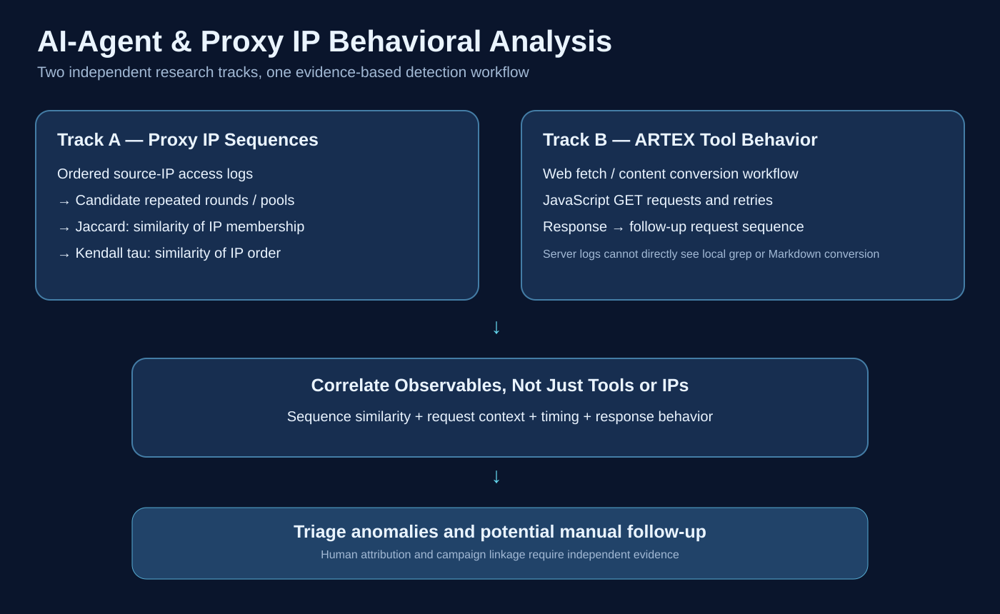

# ARTEX Behavioral Analysis

**An open defensive research project on HTTP behavior sequences, AI-agent tool usage, and rotating proxy IP pools.**

AI-assisted intrusion workflows are not reducible to one User-Agent or one source IP. This repository separates three questions:

1. **Agent tool behavior:** WebFetch-like page retrieval, HTML-to-Markdown workflows, JavaScript requests, retries, and tool switching.
2. **Proxy-pool behavior:** repeated source-IP sets, recurring traversal order, and deviations from expected cycles.
3. **Follow-up behavior:** whether focused requests occur after broader automated exploration. Human involvement is a hypothesis, not an inference from an IP alone.

> **Independent datasets.** ARTEX tool-behavior experiments and proxy-IP sequence analysis are distinct research tracks. They do not establish a shared incident, actor, or campaign. Only synthetic demonstration IPs are published.



## Quick start

Run the offline analyzer with Python 3.10+ (standard library only):

```bash
python3 skills/ip-sequence-clustering/scripts/analyze_ip_sequences.py \
  skills/ip-sequence-clustering/assets/demo_ip_sequence.txt --out results

python3 -m unittest discover \
  -s skills/ip-sequence-clustering/scripts/tests -v
```

The analyzer generates `report.md`, `report.json`, `memberships.csv`, and `anomalies.csv`. Preserve original chronological order, validate trusted source-IP fields and proxy headers, and rule out duplicate log ingestion before interpreting a repeated pattern.

## Approach

| Question | Method | Limitation |
| --- | --- | --- |
| Are the same IPs reused? | **Jaccard similarity** on distinct IP sets | Does not measure order |
| Do shared IPs reappear in the same order? | **Kendall tau-a** on first occurrences | Needs sufficient shared IPs |
| Where do phases and cycles start? | **Heuristic segmentation** using IP novelty and order resets | The two metrics do not discover boundaries by themselves |
| Which IPs merit follow-up? | Dominant, cross-phase and frequency-deviation candidates | Not proof of a human checker or command-and-control server |
| Can tool workflows be correlated? | Request timing, URLs, responses, sessions and fingerprints | Servers cannot directly observe Markdown conversion or local `grep` |

This method offers **heuristic segmentation plus quantitative repetition verification**, not a validated attacker attribution model.

## Documentation

- [ARTEX HTTP observables](docs/artex-http-observables.md)
- [Proxy IP sequence methodology](docs/proxy-sequence-analysis.md)
- [Behavioral detection playbook](docs/detection-playbook.md)
- [Research references and evidence boundaries](docs/references.md)
- [LinkedIn research summary (English)](docs/linkedin-post-en.md)
- [IP Sequence Clustering Skill source](skills/ip-sequence-clustering/)

## Evidence standards

Keep **direct observation**, **calculated metric**, **heuristic segmentation**, and **hypothesis** separate. Check benign crawlers, browsers, authorized scanners, CDNs and log-pipeline artifacts as alternative explanations. Do not infer the use of a specific agent, malicious intent, a human operator or a particular server role solely from one feature.

**License:** [MIT](LICENSE). Defensive research only; no operational incident IP lists, credentials, target URLs or private logs are included.
